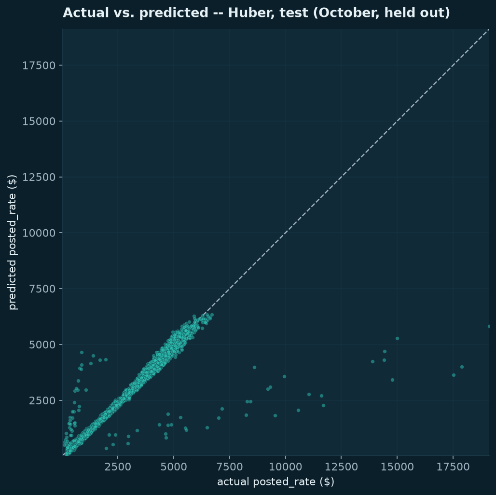

# Freight ML: Freight Rate Regression

This project estimates freight linehaul rates from load and route information using saved regression models.

## The problem

The synthetic take-home assessment asked me to predict a dollar rate for each load and a fixed route across December. I needed to compare models on later data and handle December inputs that omit two signals available in the other dataset.

## What I built

I built profiling and cleaning modules, feature preparation, eight analysis notebooks, model comparisons, residual analysis and batch prediction. Two saved Huber pipelines support the full and reduced input schemas. Huber regression limits the influence of unusually large errors.

## Architecture


## How it works

The notebooks record cleaning, exploration, feature creation, comparison and model export. For the checked inference path, `populate_predictions.py` reads the historical cleaned inputs and saved models, adds seasonal and route features, then writes new prediction files. Missing numeric values are filled within the pipeline; unseen cities and routes use the fitted training-average rate. The supplied validator checks the output shape.

## ML / AI methodology

- **Target:** `posted_rate`, the linehaul rate in dollars.
- **Inputs:** distance, weight, equipment, seasonal date signals and city/route average-rate encodings. The full model also uses `market_index` and `quote_signal`; the reduced model omits them.
- **Comparison:** mean and linear baselines, regularized linear models, Huber and tree-based regressors.
- **Validation:** January–July training, August–September model comparison and October held-out evaluation.
- **Selection:** historical Huber artifacts remain available; they do not establish an improvement over ordinary linear regression.

The city and route encodings use average target values. They were fitted before inner cross-validation, which tests settings on smaller training/validation portions. Those averages include inner validation targets: the tuning scores therefore have information leakage. October remained a separate outer test month. I have not retuned against it. See the [model card](models/MODEL_CARD.md) and [decision summary](REPORT.md).

## Engineering

The repository has shared path/split configuration, separate data and feature modules, scikit-learn preprocessing pipelines, saved model/encoder artifacts, logging and explicit missing-artifact errors. Three automated tests check boundaries and real saved-artifact inference. An offline inference workflow exists in GitHub Actions; that alone does not prove a hosted pass. There is no serving API or production deployment.

## Results

Historical October results cover **4,853 loads**; they were not reproduced by fresh training in this packaging pass.

| Measure | Huber result | Meaning |
|---|---:|---|
| Root mean squared error (RMSE) | 664.76 | Dollar error with greater weight on large misses |
| Mean absolute error (MAE) | 177.17 | Average absolute dollar error |
| Mean absolute percentage error (MAPE) | 9.40% | Average percentage error |
| R-squared | 0.811 | Fit relative to predicting a constant mean |

The recorded ordinary linear baseline had **663.24 RMSE**, slightly better than Huber. On 13 October 2026, saved-model inference produced **12,000 validation predictions and 31 December predictions**, both accepted by the supplied validator; **three tests passed**. Hidden validation labels are unavailable, so format acceptance is not an accuracy result.

## Demo

This is a local batch workflow. The recorded plot below shows historical October predictions; it is not a live service.



[Final-model notebook](notebooks/08_final_model.ipynb) · [Residual plot](figures/modeling/huber_test_residuals.png)

## Run locally

From the repository root, use Python 3.12, preferably in a virtual environment:

```bash
python -m pip install -r requirements-inference.txt
python -m pytest -q
python populate_predictions.py --output-dir outputs
python score.py --predictions outputs/validation_predictions.csv --december-predictions outputs/december_chart_inputs.csv
```

These commands were checked on 13 October 2026. They run saved artifacts, not a complete cleaning/training rebuild. `requirements-inference.txt` pins the checked inference environment; `requirements.txt` is the broader notebook dependency list.

## Repository structure

| Path | Purpose |
|---|---|
| `src/` | Configuration, loading, profiling, features, evaluation and plotting |
| `notebooks/` | Historical analysis and training sequence, 01–08 |
| `data/raw/`, `data/processed/` | Supplied inputs and historical cleaned inputs |
| `models/` | Saved pipelines, encoders and model card |
| `populate_predictions.py`, `score.py` | Candidate inference and supplied format validator |
| `tests/`, `figures/` | Boundary/artifact checks and recorded analysis plots |

## Limitations

The data is synthetic; cleaning assumptions and results do not establish real freight-pricing performance or business impact. Inner tuning has the encoding limitation described above. Full cleaning/training reproduction remains unverified. Supplied materials do not establish redistribution rights; [provenance](PROVENANCE.md) records that uncertainty. The repository URL retains its original assessment name; the neutral presentation is not a full history anonymization.

## What I would improve next

1. Rebuild preprocessing and training in an isolated environment and compare artifacts and metrics.
2. Fit encoders separately within each tuning fold, with a new future holdout rather than reusing October for selection.
3. Confirm redistribution terms for supplied assessment materials before expanding distribution.

## My contribution

This is my individual assessment submission: profiling, cleaning, features, experiments, error analysis and batch inference. I used AI assistance for implementation and documentation. The provider supplied the synthetic datasets, task brief, templates and `score.py`; I do not claim those as my work or present the assessment as employment. The bundled historical commit does not independently prove every authorship boundary. [Task summary](BRIEF.md) and [provenance](PROVENANCE.md) explain the scope.
